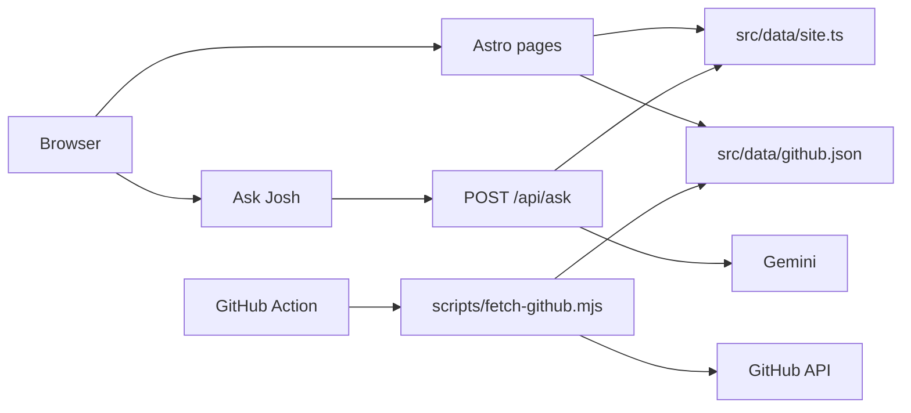

# Josh Lim

Personal portfolio for Josh Lim, an AI engineer in Singapore. Live at [joshlim.vercel.app](https://joshlim.vercel.app).

## Features

- **Pages:** Home, About, Experience, Projects, Now, and Contact. Copy lives in `src/data/site.ts`.
- **Digital card** (`/card`): photo, emails, LinkedIn and GitHub, vCard download, a QR code for the card URL, share, and a flip to the QR side.
- **Ask Josh:** a chat widget in the base layout (the bare `/card` layout leaves it out). It answers from the site content, streams the reply from Gemini through the Vercel AI SDK, and links the pages it used. Requests are rate limited.
- **Theme toggle:** light and dark, saved in `localStorage`, defaulting to the system preference.
- **Now:** current work, certifications in progress, and a GitHub contribution calendar plus the public repos listed in `src/data/github-config.json`. A daily GitHub Action refreshes `src/data/github.json`. Private activity shows up only as daily counts.

## Tech stack

- Astro 4, hybrid output, TypeScript
- Vercel, via `@astrojs/vercel` (serverless) and `@astrojs/sitemap`
- Node.js 22
- Vercel AI SDK (`ai`) and `@ai-sdk/google` for Ask Josh
- `qrcode`, used to draw the card QR at build time

## Architecture

Pages are prerendered. They read `src/data/site.ts`; Now also reads the checked-in snapshot in `src/data/github.json`. Ask Josh posts to `/api/ask`, the on-demand route (`prerender = false`). That route passes the site content as the model context and streams text from Gemini.

A scheduled workflow runs `scripts/fetch-github.mjs` against the GitHub API, commits an updated `src/data/github.json`, and that push deploys on Vercel. `npm run build` runs `astro build`, then `scripts/vercel-runtime.mjs`, which sets the function runtime to Node.js 22 and applies the host redirect in `vercel.json`.



## Run locally

Requires Node.js 22.

```bash
npm install
npm run dev          # astro dev
npm run build        # astro build && node scripts/vercel-runtime.mjs
npm run preview      # astro preview
npm run fetch:github # node scripts/fetch-github.mjs
```

## Environment variables

Names only. The pages build and render with none of these set.

| Name | Required |
| --- | --- |
| `GOOGLE_GENERATIVE_AI_API_KEY` | For `/api/ask`. Read by `@ai-sdk/google`. |
| `ASK_MODEL` | Optional override for `/api/ask`. Default is `gemini-3.5-flash-lite`. |
| `GITHUB_TOKEN` | For `npm run fetch:github`. |
